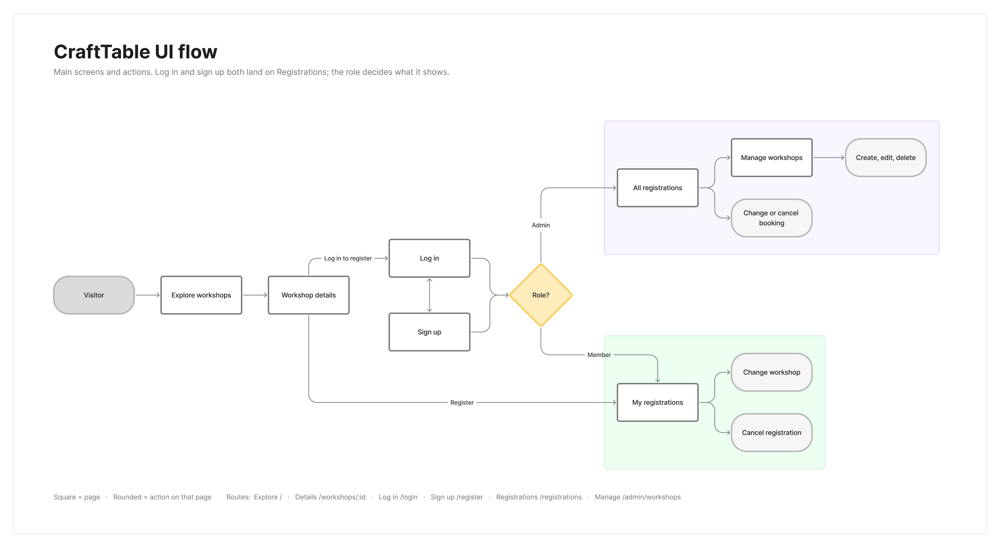

# CraftTable UI flow design

Created and source-checked: **11 November 2026**. Simplified overview, export and page designs added **16 November 2026**. Related tickets: WR-009 and WR-012.

**Editable Figma / FigJam board:** [CraftTable - Project 3 UI Flow](https://www.figma.com/board/kRQSVv6OKELAeyeGuRfK8H)

**UI flow (use this for presentations):** [UI flow section](https://www.figma.com/board/kRQSVv6OKELAeyeGuRfK8H?node-id=20-342), exported as [ui-flow.png](ui-flow.png) with its logic in [ui-flow.mmd](ui-flow.mmd). It is one page-level flowchart: Explore → Workshop details → Log in / Sign up → Role → member or admin area. Square nodes are pages and rounded nodes are actions on a page. The routes are listed under the chart.

**Page designs:** [CraftTable - Page Designs](https://www.figma.com/design/5ETqiVL4C09eBVlFAdOxnH) (Figma Design file built from the current `apps/web` code). It has a `Components` page (color variables taken from `globals.css`, text styles, icons, buttons, fields, alerts, header and footer, workshop and registration cards), a `Desktop` page with eight 1440px screens (Explore, Workshop details as guest and as member, Log in, Sign up, My registrations, All registrations, Manage workshops) and a `Mobile` page with three 390px screens (Explore, Workshop details, My registrations). Open states such as cancel confirmation, change workshop, delete workshop and the create-workshop editor are shown through component properties. Georgia and Arial are not available in Figma's font service, so the file uses their metric-compatible substitutes, Gelasio and Arimo.

The PNG is a direct export of the FigJam section (4096 px wide) and is versioned as a design deliverable, separate from temporary test screenshots. Keep the editable board URL in the presentation's UI-design link field and include the export in the hand-in package as required by [course delivery](../../course-delivery.md). Confirm the course portal's accepted attachment formats before uploading.

## Detailed journeys (archive)

The earlier detailed journeys are still on the board, in the "Archive" area to the right of the overview. They include error branches, rule notes and the demo order. They have no local PNG exports any more. Use them only when a reviewer asks about a specific branch, and delete them from the board once they are no longer needed.

| Section | Editable Figma section | Logical source |
|---|---|---|
| 01 Guest discovery and accounts | [Open section](https://www.figma.com/board/kRQSVv6OKELAeyeGuRfK8H?node-id=5-323) | [Mermaid](01-guest-accounts.mmd) |
| 02 Member registration lifecycle | [Open section](https://www.figma.com/board/kRQSVv6OKELAeyeGuRfK8H?node-id=5-326) | [Mermaid](02-member-registrations.mmd) |
| 03 Administrator workspace | [Open section](https://www.figma.com/board/kRQSVv6OKELAeyeGuRfK8H?node-id=5-329) | [Mermaid](03-admin-workspace.mmd) |
| 04 Rules, legend and presentation guide | [Open section](https://www.figma.com/board/kRQSVv6OKELAeyeGuRfK8H?node-id=5-334) | Notes in the board and [requirements](../../requirements.md) |

## What the detailed journeys record

- Guests can browse, search, open workshop details and keep a saved shortlist. Total capacity is not a remaining-seat count.
- Login and signup open `/registrations`. Signup already creates a session. The page shows the member's own records or all records for an admin.
- Member create/change/cancel paths include server rejection and retained form state. Changing a workshop preserves the registration ID and owner. Cancellation releases its seat.
- Admins manage workshops and any member registration. Workshop deletion hides the workshop and preserves history. Only members create registrations.
- All five C01-C05 conditions, UTC/today policy, active-registration definition, access control and the prescribed demo order are included in the notes.
- Returning to the selected workshop after login/signup remains **planned in WR-004**. It is labeled as planned and is not drawn as working navigation.

Rounded outcome nodes indicate the screen state reached after an action; they do not imply a new app route. Error outcomes keep the user on the current form/details so they can correct or retry. The `.mmd` files preserve the flow logic. FigJam also contains presentation notes and native connector routing, so regenerating Mermaid alone does not reproduce every annotation or visual position.

Cancellation and deletion complete only when the server accepts the request. A failed request keeps its confirmation and shows an inline error for retry; the shared rules section makes this recovery explicit.

## Review and maintenance

The source review covered current app routes, authentication forms, registration controls, admin management and backend rule semantics. Visual review checked section renders, text wrapping, arrows, labels and export readability. No app code changed and no application tests were rerun for this design-only task.

Before submission, walk one guest/member journey and one admin journey with this board open. When navigation changes, update the board, [UI-flow overview](../../ui-flow.md), [ui-flow.mmd](ui-flow.mmd) and [ui-flow.png](ui-flow.png) together. WR-012 is ready for human review; final route alignment after later implementation work remains part of WR-009.
