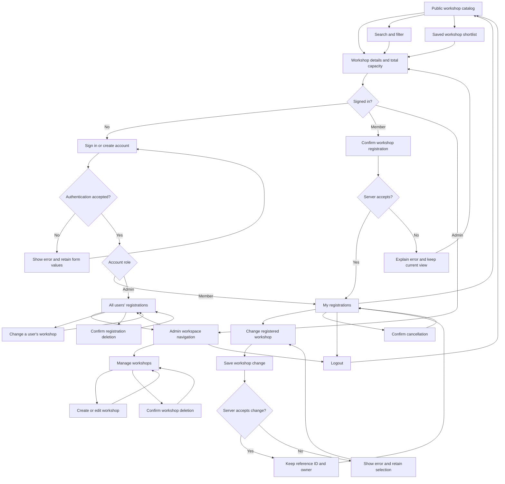

# UI flow design

The editable design is now available in [Figma / FigJam](https://www.figma.com/board/kRQSVv6OKELAeyeGuRfK8H), with [section links, PNG exports and flow sources](design/ui-flow/README.md). The board's [clean UI flow overview](https://www.figma.com/board/kRQSVv6OKELAeyeGuRfK8H?node-id=20-342) is the presentation version; page designs are in [CraftTable - Page Designs](https://www.figma.com/design/5ETqiVL4C09eBVlFAdOxnH). It contains guest/account, member and admin journeys plus rules and presentation notes.

This overview describes the implemented Project 3 flow, source-checked on 11 November 2026. Source requirements: `6901_Project_Topics-957520-17911698720803.pdf`, p4; updated design and presentation requirements: `Project-Submission-Presentation-Instructions_6aecab16d9430.pdf`, pp1–4. Track improvements in the [ticket board](tickets.md).

Successful signup already establishes a session and opens `/registrations`; it does not require an immediate second login. Both roles land on that route, which shows the member's own records or the admin's all-users list. For the prescribed presentation's separate login step, log out after signup and then log in. Returning to an intended workshop after authentication is planned in WR-004 and is not shown as completed behavior here.

The success notice on `/registrations?registered=...` is shown only when the signed-in member's authorized list contains that reference. Failed, foreign or cancelled references do not produce a success notice.

## Screen responsibilities

| Screen | Main action | Required feedback |
|---|---|---|
| Catalog | Find and open a workshop | Result count, no matches, loading, connection failure, date and total capacity. |
| Workshop details | Register or save | Instructor, description, date, location, total capacity; past/already-registered states, clear full-workshop rejection, sign-in prompt. |
| Sign up / sign in | Establish an account/session | Field labels, required-field validation, pending submit, credential errors, successful navigation. |
| My registrations | Review, change, cancel | Current registrations, active count, empty state, refreshed registration state, cancellation confirmation. |
| Admin workshops | Add, edit, delete | Complete workshop fields, validation errors, ID-linked changes, destructive-action confirmation. |
| Admin registrations | Manage a user's registration | Clear workshop and owner context, changes/cancellation feedback, rule errors. |
| Saved shortlist | Compare intended choices | Distinguish saved from registered; empty state; no reservation implied. |

## Interaction review

- Every interactive control has a visible name; keyboard users can reach actions and see focus.
- Navigation makes the current role and section clear. Guest/member/admin controls match permissions.
- Errors preserve useful form input and explain how to recover. A failed request never displays a false success.
- Disable duplicate submission while pending. Refresh registration state after successful changes; capacity is a total, not a remaining-place count.
- Cancellation and workshop deletion require a clear confirmation with the affected record identified.
- Layout works on a narrow phone screen and a desktop; cards, forms, tables, and dialogs stay usable.
- Distinguish workshop date, total capacity, registration state, and the three-active-workshop limit. Do not rely on color alone.

For the presentation, show the diagram and follow one guest-to-member journey plus one admin journey. Confirm actual screen names and routes before using this document as final submission evidence.
